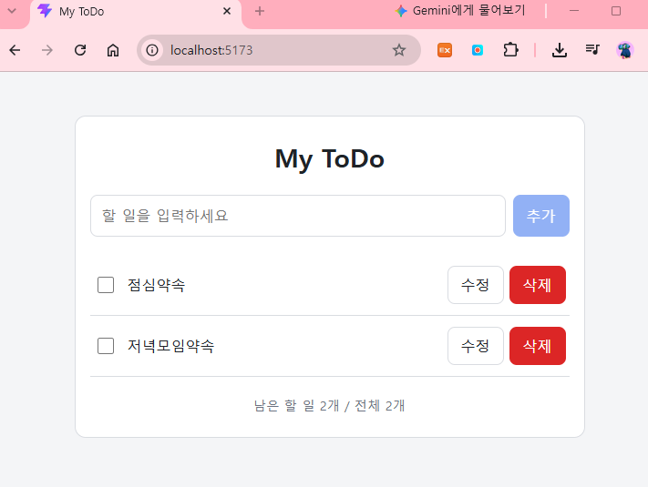
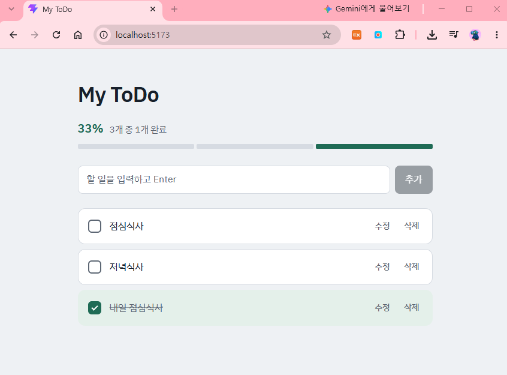
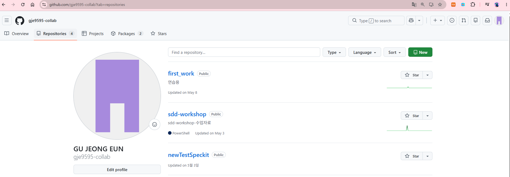
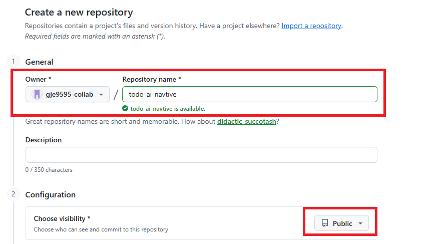
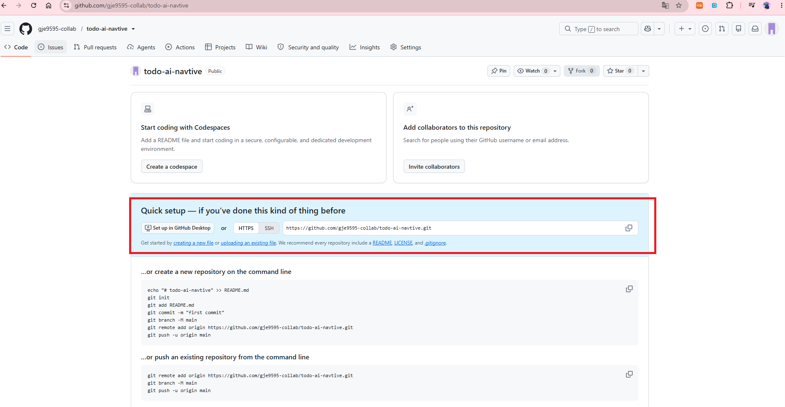
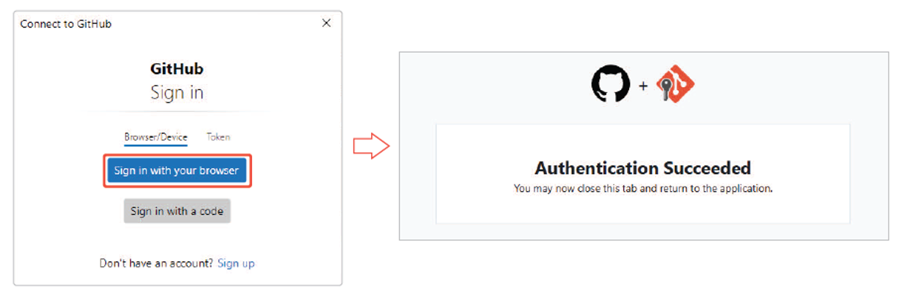
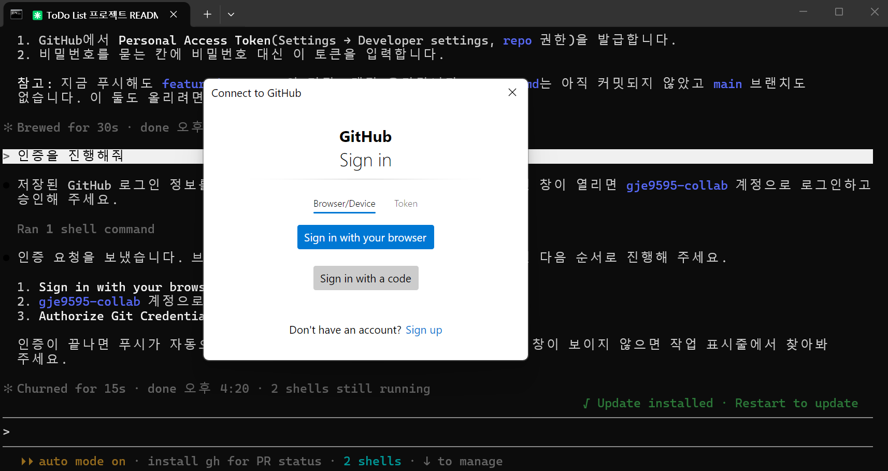
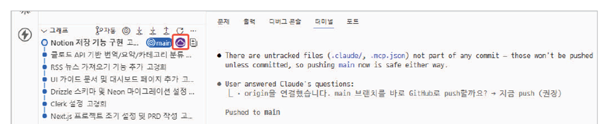

# Claude Code 기반 AI Native ToDo List 웹앱 개발 교육과정

> Vibe Coding → Frontend Design → Context Engineering → SDD → Harness Engineering → Agentic Development

---

# 1. 교육과정 개요

## 1-1. 교육 목표

본 교육은 Claude Code를 활용하여 하나의 ToDo List 웹 애플리케이션을 단계적으로 완성하면서 AI Native 소프트웨어 개발 방법론을 학습하는 프로젝트 중심 실습 과정입니다.

처음에는 프롬프트만으로 웹앱을 생성하고, Frontend Design Plugin으로 UI를 개선합니다.

이후 CLAUDE.md와 PRD를 활용해 개발 기준을 명확히 하고, Command, Skill, Hook, Subagent, MCP, Plugin을 순차적으로 적용합니다.

최종적으로 다음 두 가지 결과물을 완성합니다.

1. **ToDo List 웹 서비스**
   - React + FastAPI + Supabase + Vercel 기반
   - 실제 배포 가능한 웹 애플리케이션

2. **AI 개발 하네스**
   - 요구사항 분석
   - 기능 구현
   - 테스트 및 자동 검증
   - 전문 에이전트 협업
   - 외부 도구 연동
   - 재사용 가능한 Claude Code Plugin

## 1-2. 전체 교육 로드맵

### Phase 1. Vibe Coding
- Git 및 Branch
- Prompt Engineering
- React 기본 UI 생성
- Frontend Design Plugin
- 반응형 UI 개선

### Phase 2. Context Engineering & SDD
- Context Engineering
- CLAUDE.md
- PRD 작성
- API 및 DB 명세
- 수용 기준 정의
- MCP

### Phase 3. Full-stack Development
- Monorepo
- React + FastAPI
- REST API
- Supabase PostgreSQL
- Vercel 배포

### Phase 4. Harness Engineering
- Command
- Skill
- Hook
- Subagent

### Phase 5. Agentic Development(제외)
- Custom Plugin
- 통합 검증
- AI 개발 하네스 완성

---

# 2. 교육 운영 계획

## 2-1. 교육 개요

| 항목 | 내용 |
|---|---|
| 교육명 | Claude Code 기반 AI Native ToDo List 개발 |
| 총 교육시간 | 26시간 |
| 전체 모듈 | 13개 |
| 모듈별 시간 | 2시간 |
| 실습 비중 | 약 70% |
| 교육 방식 | 프로젝트 기반 실습 |
| 최종 결과물 | ToDo 서비스 + Claude Code Plugin |

## 2-2. 기술 스택

| 구분 | 사용 기술 |
|---|---|
| AI 개발 | Claude Code |
| IDE | VS Code |
| 버전 관리 | Git, GitHub |
| 프론트엔드 | React, Vite, JavaScript |
| 디자인 | Frontend Design Plugin |
| 백엔드 | Python, FastAPI |
| 데이터베이스 | Supabase PostgreSQL |
| 배포 | Vercel |
| API 테스트 | Pytest, Swagger UI |
| E2E 테스트 | Playwright |
| 개발 자동화 | Command, Skill, Hook |
| 에이전트 | Claude Code Subagent |
| 외부 도구 | MCP |
| 패키징 | Claude Code Plugin |

## 2-3. 전체 교과목 편성표

| 모듈 | 교과목 | 핵심 기술 | 시간 |
|---|---|---|---|
| 1 | 개발 환경 및 프로젝트 관리 | Claude Code, Git, Branch | 2h |
| 2 | 프롬프트 기반 UI 개발 | Prompt Engineering, React | 2h |
| 3 | Frontend Design Plugin | Frontend Plugin, UI/UX | 2h |
| 4 | Context Engineering | CLAUDE.md, Context | 2h |
| 5 | 요구사항 및 설계 | PRD, SDD, API Spec | 2h |
| 6 | 풀스택 앱 구현 | Monorepo, React, FastAPI | 2h |
| 7 | DB 연동 및 배포 | Supabase, Vercel | 2h |
| 8 | Command 기반 개발 | Custom Slash Command | 2h |
| 9 | Skill 기반 개발 | SKILL.md, References | 2h |
| 10 | Hook 자동 검증 | Hook, ESLint, Ruff | 2h |
| 11 | Subagent 기반 개발 | Planner, Developer, Reviewer | 2h |
| 12 | MCP 기반 도구 연동 | GitHub, Supabase, Playwright | 2h |
| 13 | Custom Plugin 및 최종 평가 | Plugin, Harness | 2h |
| **합계** | | | **26h** |

---

# 3. 최종 프로젝트 기능 정의

## 3-1. ToDo List 기능 확장 계획

| 개발 단계 | ToDo List 기능 | 학습 목적 |
|---|---|---|
| 기본 UI | 할 일 입력, 목록, 체크박스 | 프롬프트 기반 개발 |
| Frontend Plugin | 디자인 개선, 반응형 UI | UI 전문 도구 활용 |
| Context | 컴포넌트 구조 및 UI 규칙 정리 | 개발 일관성 |
| SDD | CRUD 요구사항 및 API 설계 | 명세 기반 개발 |
| Full-stack | 생성·조회·수정·삭제 | 프론트·백엔드 통합 |
| Supabase | DB 영구 저장 | 데이터 연동 |
| Vercel | 웹 서비스 배포 | 운영 환경 이해 |
| Command | 마감일 기능 | 반복 개발 명령화 |
| Skill | 카테고리·필터 | 개발 절차 재사용 |
| Hook | 입력값 검증 | 자동 품질 검사 |
| Subagent | 우선순위·정렬 | 전문 에이전트 협업 |
| MCP | GitHub Issue 기반 기능 개선 | 외부 도구 활용 |
| Plugin | 개발 도구 패키징 | 하네스 재사용 |

---

# 4. 모듈별 상세 교육내용

## Module 1. Claude Code 개발 환경 및 Git Branch

### 4-1-1. 학습 목표

Claude Code의 기본 실행 구조를 이해하고 Git 브랜치를 이용한 AI 개발 환경을 구성합니다.

### 4-1-2. 핵심 교육내용

- Branch: 개발 작업의 이력과 흐름을 분리하는 기능(개발 이력 분리)
- Worktree: 하나의 Git 저장소를 공유하면서 여러 브랜치를 서로 다른 디렉터리에서 동시에 작업할 수 있도록 하는 기능(작업 디렉토리 분리)
    - AI Native 개발에서는 Worktree를 이용하여 여러 AI 코딩 에이전트가 하나의 프로젝트를 병렬 개발하도록 구성할 수 있다.
- 즉, Branch는 논리적인 작업 분리, Worktree는 물리적인 작업 공간 분리

| 구분 | 교육 내용 |
|---|---|
| Claude Code | CLI, 세션, 도구 호출, 권한 승인 |
| Git | Repository, Commit, Branch, Merge |
| GitHub | 원격 저장소, Push, Pull Request |
| Branch 전략 | main, develop, feature |
| Worktree | 독립적인 작업 디렉터리 |

예)

| 개념 | 의미 | 예시 |
|---|---|---|
| 프로젝트(Project) | 개발하려는 소프트웨어 전체 | ToDo App |
| 저장소(Repository) | Git이 버전 이력을 관리하는 단위 | `todo-app/.git` |
| 작업 디렉터리(Working Directory) | 실제 소스코드를 수정하는 폴더 | `todo-app/` |
| 브랜치(Branch) | 개발 이력을 구분하는 논리적 분기 | `feature/login` |
| 워크트리(Worktree) | Git 저장소에 연결된 실제 작업 디렉터리 | `todo-login/`, `todo-ui/`

```text
Git Repository (하나의 저장소)
│
├── todo-app/          ← main 브랜치
│
├── todo-login/        ← feature/login 브랜치
│
└── todo-ui/           ← feature/ui 브랜치

```

### 4-1-3. 실습 절차

1. Claude Code 설치 및 로그인
2. 프로젝트 디렉터리 생성
3. Git 저장소 초기화
4. develop 브랜치 생성
5. feature 브랜치 생성
6. Claude Code 실행
7. README.md 작성
8. Git Commit 및 PR 생성

### 4-1-4. 실습 명령

```bash
    mkdir todo-ai-native
    cd todo-ai-native

    git init
    git branch -M main

    git checkout -b develop
    git checkout -b feature/todo-init

    claude
```

| 순서 | 명령어 | 실행 결과 |
|---|---|---|
| 1 | `mkdir todo-ai-native` | 프로젝트 디렉터리 생성 |
| 2 | `cd todo-ai-native` | 프로젝트 디렉터리로 이동 |
| 3 | `git init` | `.git/` 생성 및 Git 저장소 초기화,  현재 디렉터리를 Git이 버전 관리할 수 있는 로컬 저장소(Repository)로 초기화하는 명령어|
| 4 | `git branch -M main` | 초기 브랜치 이름을 `main`으로 지정 |
| 5 | `git checkout -b develop` | `develop` 브랜치로 전환 |
| 6 | `git checkout -b feature/todo-init` | `feature/todo-init` 브랜치로 전환 |
| 7 | `claude` | 현재 디렉터리에서 Claude Code 실행 |


### 4-1-5. Claude Code 실습 프롬프트

> React, FastAPI, Supabase, Vercel을 사용하는 ToDo List 프로젝트를 만들 예정입니다.
>
> 현재 Git 브랜치를 확인하고 프로젝트 목적, 기술 스택, 초기 디렉터리 구조를 README.md에 정리하세요.
>
> 아직 기능 코드는 작성하지 마세요.

[답변예시] README.md
```markdown
# todo-ai-native

React, FastAPI, Supabase, Vercel로 만드는 ToDo List 웹 애플리케이션입니다.

> 현재 상태: 프로젝트 초기화 단계입니다. 기능 코드는 아직 없습니다.

## 프로젝트 목적

- 할 일을 추가, 조회, 수정, 완료 처리, 삭제할 수 있는 ToDo List 서비스를 만듭니다.
- 프론트엔드(React)와 백엔드(FastAPI)를 나누고, 데이터 저장과 인증은 Supabase에 맡깁니다.
- 프론트엔드와 백엔드 모두 Vercel에 배포합니다.
- 작은 단위의 브랜치와 커밋으로 기능을 하나씩 추가합니다.

## 기술 스택

| 영역 | 기술 | 역할 |
| --- | --- | --- |
| Frontend | React (Vite, TypeScript) | 사용자 화면, API 호출 |
| Backend | FastAPI (Python) | REST API, 비즈니스 로직, 입력 검증 |
| Database / Auth | Supabase (PostgreSQL, Supabase Auth) | ToDo 데이터 저장, 사용자 인증 |
| Deployment | Vercel | 프론트엔드 정적 호스팅, FastAPI 서버리스 함수 |

## 초기 디렉터리 구조

todo-ai-native/
├── frontend/              # React 앱 (Vite)
│   ├── public/
│   ├── src/
│   │   ├── components/    # 재사용 UI 컴포넌트
│   │   ├── pages/         # 화면 단위 컴포넌트
│   │   ├── api/           # 백엔드 API 호출 모듈
│   │   └── lib/           # Supabase 클라이언트 등 공통 유틸
│   └── package.json
├── backend/               # FastAPI 앱
│   ├── app/
│   │   ├── main.py        # FastAPI 진입점
│   │   ├── routers/       # API 라우터 (todos 등)
│   │   ├── schemas/       # Pydantic 요청/응답 모델
│   │   ├── services/      # 비즈니스 로직
│   │   └── core/          # 설정, Supabase 연결
│   ├── tests/
│   └── requirements.txt
├── supabase/
│   └── migrations/        # DB 스키마 마이그레이션 SQL
├── docs/                  # 설계 문서
├── .gitignore
└── README.md
```
```markdown
위 구조는 계획이며, 각 디렉터리는 해당 기능을 구현할 때 만듭니다.

## 브랜치 전략

- `main`: 배포 가능한 안정 브랜치
- `feature/*`: 기능 개발 브랜치 (현재 브랜치: `feature/todo-init`)

## 환경 변수 (예정)

| 이름 | 사용처 | 설명 |
| --- | --- | --- |
| `VITE_API_BASE_URL` | frontend | FastAPI 서버 주소 |
| `VITE_SUPABASE_URL` | frontend | Supabase 프로젝트 URL |
| `VITE_SUPABASE_ANON_KEY` | frontend | Supabase 공개(anon) 키 |
| `SUPABASE_URL` | backend | Supabase 프로젝트 URL |
| `SUPABASE_SERVICE_ROLE_KEY` | backend | Supabase 서비스 키 (서버에서만 사용, 커밋 금지) |
```
```markdown
### 4-1-6. 산출물

- GitHub Repository
- Git Branch
- README.md
- Pull Request

### 4-1-7. 완료 기준

- 기능 브랜치 생성
- 변경 사항 Commit
- GitHub Push
- Pull Request 생성
```
---

## Module 2. Prompt Engineering 기반 ToDo UI 구현

### 4-2-1. 학습 목표

자연어 프롬프트로 React 기반 ToDo List 화면을 구현하고 프롬프트 중심 개발의 장단점을 이해합니다.

### 4-2-2. 핵심 교육내용

| 구분 | 교육 내용 |
|---|---|
| Prompt Engineering | 역할, 작업, 제약, 출력 |
| React | Component, State, Event |
| Vite | 프로젝트 생성 및 개발 서버 |
| UI | 입력창, 버튼, 목록 |
| 비교 | 단순 프롬프트와 구조화 프롬프트 |

### 4-2-3. 실습 기능

1. ToDo 입력
2. ToDo 목록 표시
3. 완료 체크
4. 제목 수정
5. ToDo 삭제

### 4-2-4. 실습 프롬프트

> React + Vite를 이용해 ToDo List 웹앱을 만들어 주세요.
>
> 화면에는 다음 기능이 필요합니다.
>
> 1. My ToDo 제목
> 2. 할 일 입력창
> 3. 추가 버튼
> 4. 할 일 목록
> 5. 완료 체크박스
> 6. 수정 및 삭제 버튼
>
> 지금은 백엔드나 DB를 사용하지 않고 React 상태로만 구현하세요.
>
> 외부 UI 라이브러리는 사용하지 마세요.

실행
```bash
cd frontend
npm run dev
```


### 4-2-5. 산출물

- React 프로젝트
- ToDo 기본 UI
- App.jsx
- 컴포넌트 코드

### 4-2-6. 완료 기준

- 할 일 추가
- 할 일 수정
- 완료 상태 변경
- 할 일 삭제

---

## Module 3. Frontend Design Plugin 기반 UI/UX 개선

### 4-3-1. 학습 목표

Claude Code의 Frontend Design 기능을 활용하여 기존 ToDo UI를 개선하고 디자인 규칙을 문서화합니다.

### 4-3-2. 핵심 교육내용

| 구분 | 교육 내용 |
|---|---|
| Plugin | Claude Code 확장 기능 |
| Frontend Design | UI 디자인 및 구현 지원 |
| Layout | 화면 배치 및 구성 |
| Typography | 글꼴과 시각적 계층 |
| Color | 디자인 색상 체계 |
| Spacing | 여백 및 간격 |
| Responsive | 반응형 UI |
| Accessibility | 접근성 |

### 4-3-3. 실습 A. Frontend Plugin 설치

Claude Code에서 다음 명령을 실행합니다.

    /plugin

플러그인 탐색 화면에서 `frontend-design` 기능을 확인하고 설치합니다.

| 메뉴 | 기능 |
|---|---|
| **Discover** | 설치 가능한 플러그인 검색 및 탐색 |
| **Installed** | 현재 설치된 플러그인 확인 및 관리 |
| **Marketplaces** | 플러그인을 제공하는 마켓플레이스 관리 |
| **Errors** | 플러그인 설치 및 실행 오류 확인 |
| **Stats** | 플러그인 관련 통계 확인 |

설치 가능 여부와 명령은 실제 Claude Code 환경에 따라 확인합니다.



### 4-3-4. 실습 B. UI 개선

> frontend-design 기능을 활용하여 기존 ToDo List UI를 전문적인 생산성 관리 앱 스타일로 개선하세요.
>
> 요구사항:
>
> 1. 미니멀한 레이아웃
> 2. 완료율 표시
> 3. 작업 카드 UI
> 4. 일관된 색상과 폰트
> 5. 모바일 반응형
> 6. 키보드 접근성
> 7. 명확한 포커스 표시
>
> 기존 기능은 유지하고 변경 전후 UI를 비교하세요.

```prompt
Restart to update
```



[추가예시]
```prompt
frontend-design 기능을 활용하여 기존 ToDo List 앱에 생산성 관리 대시보드 UI를 추가하세요.

**요구사항:**

1. 오늘의 작업, 진행 중인 작업, 완료된 작업을 구분하는 대시보드 구성
2. 전체 작업 수, 완료 작업 수, 미완료 작업 수를 표시하는 통계 카드
3. 작업 완료율을 시각적으로 표현하는 원형 프로그레스 UI
4. 전체 / 진행 중 / 완료 작업을 전환하는 필터 탭
5. 작업 우선순위(높음 / 보통 / 낮음)에 따른 색상 배지
6. 작업이 없을 때 표시되는 Empty State 디자인
7. 데스크톱에서는 2열, 모바일에서는 1열 중심의 반응형 레이아웃
8. 키보드 접근성과 명확한 포커스 표시
9. 기존 ToDo 등록·수정·삭제·완료 기능 유지
10. 기존 기술 스택과 API 구조를 유지하고 불필요한 라이브러리 추가 금지

**작업 절차:**

1. 기존 프로젝트의 프론트엔드 구조와 UI 분석
2. frontend-design 기능을 활용한 대시보드 디자인 설계
3. 재사용 가능한 통계 카드 및 작업 카드 컴포넌트 구현
4. 기존 ToDo 데이터와 대시보드 UI 연결
5. 모바일 반응형 및 접근성 검증
6. 기존 기능에 대한 회귀 테스트
7. 변경 전후 UI를 동일한 화면 크기에서 캡처하여 비교

**결과물:**

- 개선된 대시보드 UI
- 변경 또는 추가된 컴포넌트 목록
- 변경 전후 UI 비교
- 기존 기능 유지 여부 및 테스트 결과
- 추가 개선이 필요한 사항
```

### 4-3-5. 실습 C. 디자인 규칙 문서화

다음 파일을 작성합니다.

    docs/ui-guidelines.md

포함 내용:

- Color System
- Typography
- Spacing
- Component Rules
- Responsive Breakpoints
- Accessibility Rules

### 4-3-6. 산출물

- 개선된 React UI
- TaskCard 컴포넌트
- TaskForm 컴포넌트
- UI Guidelines
- 반응형 화면

### 4-3-7. 완료 기준

- 기존 CRUD UI 기능 유지
- 모바일 반응형 지원
- 일관된 디자인 적용
- UI 규칙 문서화

예시) docs/ui-guidelines.md
```
## UI Design Rules

- 모든 UI 개발 시 docs/ui-guidelines.md를 참조한다.
- 새로운 컴포넌트는 정의된 Color, Typography, Spacing 규칙을 따른다.
- TaskCard와 TaskForm은 공통 디자인 토큰을 사용한다.
- 반응형 UI와 키보드 접근성을 반드시 고려한다.
- UI 변경 시 docs/ui-guidelines.md를 함께 업데이트한다.
- 기존 CRUD 기능을 유지하고 변경 후 테스트한다.
```

## Module 4. 완성된 앱을 깃허브에 올리기

### 1. .gitignore 파일 확인하기
```bash
git init
```
- 깃이 추적하지 않을 파일과 폴더 목록을 정의하는 파일
- .gitignore는 깃허브에도 업로드되지 않음
- API 키나 데이터베이스 비밀번호 등은 .env.local에 환경변수로 저장 
 ==> .env.local 파일을 .gitignore에 포함시킴.

 
[주의사항]
```
저장소 Settings → General → Default branch에서 main으로 바꿔 주세요
```

### 2. 깃허브에 코드를 올리기 위한 저장소(리포지토리, repository) 만들기
1.깃허브(github.com)에 회원 가입 후 로그인
2.[New] 클릭
3. 저장소 이름 입력 후 [Create repository] 클릭 
- Repository name: 저장소 이름 입력
- Description: 저장소에 대한 설명 입력(선택 사항)
- Visibility: 저장소 공개 여부 선택. 기본값 Public
- 그 외 옵션: 기본값 그대로 



4. 깃허브 저장소 주소 복사



### 3. 로컬 저장소를 깃허브에 연결하기

https://github.com/gje9595-collab/todo-ai-navtive.git

```
현재 저장소를 깃허브 저장소 [복사한 주소 붙여넣기]에 연결해 줘
```



origin에 연결이 되었다면 '1. 지금 push(권장)' 선택하거나 입력
```
push해줘
```
처음 푸시할 때는 깃허브 인증 필요함. 
로그인 창에서 [Sign in with your browser] 클릭
'Authentication Succeeded' 나타나면 인증 완료. -> 인증 확인 창은 닫아도 됨



인증이 안될 경우, 직접 입력하여 진행한다.
```
인증을 진행해줘
```


푸시가 끝난 후 VSCode의 소스제어창 확인 --> 최종 커밋 메시지에 (보라색)표시되어있음



브라우저에서 깃허브 저장소를 새로고침해서 확인해도 된다.


[참고]
```bash
mkdir todo-ai-native
cd todo-ai-native

git init
git branch -M main

git checkout -b develop
git checkout -b feature/todo-init

claude
```
브랜치 위치가 잘못된 경우
예를 들어 현재 feature/todo-init에 있을 경우,

[간략버전]
```
현재 `feature/todo-init` 브랜치의 작업을 `develop`을 거쳐 `main`까지 통합해줘.

각 단계에서 PR 생성 → 검증 → Merge를 수행하고, 충돌이나 오류가 발생하면 중단 후 보고해줘.

마지막으로 로컬 `main`을 최신 상태로 동기화하고 결과를 알려줘.
```

[정식버전]
```
진행 순서:
1. .gitignore 커밋 푸시
2. main을 기준으로 develop 브랜치 생성
3. PR feature/todo-init → develop 생성, 검증, Merge
4. PR develop → main 생성, 검증, Merge
5. 로컬 main 동기화
```

---

## Module 5. Context Engineering과 CLAUDE.md

### 5-1. 학습 목표

Claude Code가 프로젝트 구조와 개발 규칙을 일관되게 참조하도록 Context를 구성합니다.

### 5-2. 핵심 교육내용

| 구분 | 교육 내용 |
|---|---|
| Prompt | 현재 작업 지시 |
| Context | AI가 참고하는 정보 |
| CLAUDE.md | 프로젝트 개발 규칙 |
| Session | 대화 및 작업 맥락 |
| Tool Results | 도구 실행 결과 |
| External Documents | PRD, API 명세, UI 규칙 |

### 5-3. Context 구성요소

1. 시스템 지침
2. 사용자 프롬프트
3. 프로젝트 파일
4. 외부 문서
5. 도구 실행 결과
6. 현재 작업 상태

### 5-4. CLAUDE.md 예시

- 현재 프로젝트를 기반으로 정보를 스캔 후 CLAUDE.md를 생성하고 이에 반영한다.

```bash
/init
```

# CLAUDE.md

```markdown
    ## Project
    AI Native ToDo List

    ## Tech Stack
    - React + Vite
    - FastAPI
    - Supabase PostgreSQL
    - Vercel

    ## Architecture
    - frontend/: React UI
    - backend/: FastAPI
    - supabase/: DB schema
    - docs/: specifications
    - tests/: tests

    ## Development Rules
    1. 기존 코드 구조를 먼저 확인한다.
    2. 변경 전 구현 계획을 제시한다.
    3. PRD와 API 명세를 준수한다.
    4. UI는 docs/ui-guidelines.md를 따른다.
    5. 기존 기능을 유지한다.
    6. 구현 후 테스트 결과를 보고한다.
    7. 비밀 키를 코드에 포함하지 않는다.
```
### [핵심용어정리] Monorepo 기반 React + FastAPI 구현

**Monorepo 기반 React + FastAPI 구현**이란 하나의 Git 저장소에서 React로 프론트엔드를 개발하고, FastAPI로 백엔드를 개발하여 하나의 웹 애플리케이션으로 통합하는 개발 방식입니다.

---

#### 1. 핵심 용어 정리

| 용어 | 정의 | 역할 |
|---|---|---|
| **Monorepo** (모노레포) | 여러 프로젝트를 하나의 저장소에서 관리하는 방식 | 프론트엔드·백엔드·공통 설정 통합 관리 |
| **React** | JavaScript 기반 UI 개발 라이브러리 | 사용자 화면(Frontend) 구현 |
| **FastAPI** | Python 기반 웹 API 프레임워크 | 서버 로직 및 REST API 구현, 적은 코드로 API를 구현하고 자동으로 문서화할 수 있음 |
| **Frontend** | 사용자가 직접 접하는 화면 영역 | 화면 출력, 사용자 입력, API 요청 |
| **Backend** | 서버에서 실행되는 프로그램 영역 | 비즈니스 로직, 데이터 처리, DB 연동 |
| **REST API** | HTTP를 활용해 클라이언트와 서버가 데이터를 주고받는 인터페이스 설계 방식 | React와 FastAPI 간 통신 |
| **JSON** | 데이터를 구조화하여 표현하는 형식 | API 요청·응답 데이터 전달 |
| **Git Repository** | 소스코드와 변경 이력을 관리하는 저장소 | 프로젝트 버전 관리 |
| **Vite** | 프론트엔드 개발 및 빌드 도구 | React 개발 서버 및 배포용 빌드 |
| **Uvicorn** | Python ASGI 서버 | FastAPI 애플리케이션을 실행하는 서버 |

**FASTAPI : Python 기반의 고성능 웹 API 프레임워크로, REST API 개발과 AI 서비스 백엔드 구현에 적합**
---

#### 2. 전체 아키텍처

```text
                  ┌──────────────────────┐
                  │    사용자 (Browser)   │
                  │  ToDo 등록/조회/수정  │
                  └──────────┬───────────┘
                             │
                             ▼
                  ┌──────────────────────┐
                  │   React Frontend     │
                  │                      │
                  │  - UI 컴포넌트        │
                  │  - 상태 관리          │
                  │  - Vite 개발 도구     │
                  └──────────┬───────────┘
                             │
                        HTTP / JSON
                         REST API
                             │
                             ▼
                  ┌──────────────────────┐
                  │   FastAPI Backend    │
                  │                      │
                  │  - REST API          │
                  │  - 비즈니스 로직      │
                  │  - Uvicorn 서버      │
                  └──────────┬───────────┘
                             │
                             ▼
                  ┌──────────────────────┐
                  │      Supabase        │
                  │     PostgreSQL       │
                  │                      │
                  │  - ToDo 데이터 저장   │
                  │  - 데이터 조회/수정   │
                  └──────────────────────┘
```


### 5-5. 실습 프롬프트

> 현재 프로젝트를 분석하고 CLAUDE.md를 작성하세요.
>
> 기술 스택, 폴더 구조, UI 디자인 규칙, API 개발 규칙, 테스트 정책을 포함하세요.
>
> 이후 새 세션에서도 이 규칙을 활용할 수 있도록 구성하세요.

### 5-6. 산출물

- CLAUDE.md
- Context 구성 문서
- 개발 규칙

### 5-7. 완료 기준

새로운 Claude Code 세션에서도 동일한 프로젝트 구조와 개발 규칙을 준수해야 합니다.

---

## Module 6. PRD 및 SDD 기반 설계

### 6-1. 학습 목표

자연어 요구사항을 구현 가능한 문서로 변환하고 수용 기준을 정의합니다.

### 6-2. 핵심 교육내용

| 문서 | 주요 내용 | 산출물 |
|---|---|---|
| PRD | 제품 목표, 사용자, 핵심 기능 | PRD.md |
| Requirements | 기능·비기능 요구사항 | requirements.md(여기서는 CLADUE.md) |
| API Spec | REST API 계약 | api-spec.md |
| DB Schema | 테이블·필드·제약조건 | db-schema.md |
| Acceptance | Given-When-Then | acceptance-criteria.md |
| Tasks | 구현 순서 및 작업 단위 | tasks.md |

### 6-3. 기능 요구사항

| ID | 기능 | 수용 기준 |
|---|---|---|
| FR-001 | 할 일 생성 | 정상 입력 시 목록에 추가 |
| FR-002 | 목록 조회 | 저장된 항목 표시 |
| FR-003 | 제목 수정 | 변경된 제목 저장 |
| FR-004 | 완료 상태 변경 | 체크 상태 유지 |
| FR-005 | 삭제 | 삭제 후 목록에서 제거 |

### 6-4. 실습 프롬프트

> 현재 ToDo 앱의 요구사항을 분석하여 docs/PRD를 작성하세요.
>
> 이후 API 명세, DB 스키마, 수용 기준, 구현 TASKS를 docs/*에 생성하세요.
>
> 모든 문서는 요구사항 ID로 연결하고 구현 전에 명세의 누락과 충돌을 검토하세요.

### 6-5. 산출물

    docs/
    ├── PRD.md
    ├── requirements.md
    ├── api-spec.md
    ├── db-schema.md
    ├── acceptance-criteria.md
    └── tasks.md

### 6-6. 완료 기준

각 기능의 요구사항, API, DB 구조, 테스트 기준을 추적할 수 있어야 합니다.


---

## Module 7. Monorepo 기반 React + FastAPI 구현

### 7-1. 학습 목표

React와 FastAPI를 하나의 Git 저장소에서 관리하고 CRUD API를 구현합니다.

- React와 FastAPI를 하나의 Git 저장소에서 관리하고 CRUD API를 구현합니다.
- Monorepo는 코드를 어떻게 관리할 것인가에 관한 저장소 전략입니다.
- React는 사용자 화면을 어떻게 구현할 것인가에 관한 기술입니다.

### 7-2. 핵심 교육내용

| 구분 | 교육 내용 |
|---|---|
| Monorepo | 단일 저장소에서 다중 앱 관리 |
| React | Component, State, API Client |
| FastAPI | Router, Service, Repository |
| REST API | GET, POST, PATCH, DELETE |
| HTTP | Request, Response, JSON |
| CORS | Cross-Origin 요청 |
| Test | Pytest, Swagger UI |

### 7-3. 서비스 구조

    React Frontend
          |
          | HTTP / JSON
          v
    FastAPI Backend
          |
          v
        Router
          |
          v
        Service
          |
          v
       Repository
          |
          v
    In-Memory Storage

### 7-4. API 설계

| Method | Endpoint | 기능 |
|---|---|---|
| GET | /api/todos | 목록 조회 |
| POST | /api/todos | 등록 |
| PATCH | /api/todos/{id} | 수정 |
| DELETE | /api/todos/{id} | 삭제 |

### 7-5. 실습 프롬프트

> PRD와 API 명세를 기준으로 React와 FastAPI를 연동하세요.
>
> Backend는 Router, Service, Repository 계층으로 분리하고 현재는 In-Memory 저장소를 사용하세요.
>
> CRUD 구현 후 API 테스트를 작성하고 실행하세요.

### 7-6. 산출물

- frontend/
- backend/
- API Router
- Service
- Repository
- Pytest 코드

### 7-7. 완료 기준

React UI에서 FastAPI를 통해 CRUD 기능이 정상 작동해야 합니다.

```prompt
서버를 실행해줘
```

---
## Module 8. Supabase MCP 연동 및 Vercel 배포 [선택]

### 8-1. 학습 목표

Module 7에서 구현한 **React + FastAPI + In-Memory Repository**를 유지한 상태에서 데이터 저장소만 Supabase PostgreSQL로 교체하고, GitHub와 Vercel을 이용해 배포합니다. Claude Code의 Supabase MCP는 **개발 시 DB 조회·스키마 관리·검증**에 활용하며, 실제 서비스는 **FastAPI → Supabase SDK/API**로 통신합니다.

> 선행 조건: Module 7의 `/api/todos` CRUD가 동작하고 `docs/PRD.md`, `docs/api-spec.md`, `docs/db-schema.md`, `docs/acceptance.md`, `CLAUDE.md`를 확인할 수 있어야 합니다. 문서나 코드가 다르면 실제 구현과 승인된 API 명세를 먼저 대조합니다.

### 8-2. 핵심 교육내용

| 구분 | 교육 내용 |
|---|---|
| Supabase MCP | Claude Code 연결, 프로젝트·테이블 조회, 승인 후 SQL 실행 |
| PostgreSQL | `todos` 테이블, UUID, 데이터 영속성 |
| RLS/보안 | RLS 활성화, 서버 전용 Secret Key, 공개 접근 차단 |
| Repository | In-Memory → Supabase 교체, Router/Service/API 계약 유지 |
| 테스트 | Pytest, `/api/todos` CRUD, 새로고침·재시작 영속성 |
| GitHub | 현재 브랜치 확인, PR 및 main 병합 |
| Vercel | 프론트엔드·백엔드 프로젝트, 환경변수, API URL, 배포 검증 |

### 8-3. 아키텍처

```text
[개발 시]
개발자 → Claude Code → Supabase MCP → Supabase PostgreSQL
                   └→ 코드·테스트·배포 설정 변경

[실행 시]
브라우저 → React (Vercel) → /api/todos (FastAPI / Vercel) → Supabase SDK/API → PostgreSQL
```

**중요:** MCP는 배포된 웹앱의 DB 연결 경로가 아닙니다. Vercel 배포는 GitHub 연동 또는 Vercel CLI를 별도로 사용합니다.

### 8-4. 단계별 실습

#### STEP 1. Supabase 프로젝트 확인

1. [Supabase Dashboard](https://supabase.com/dashboard)에 로그인합니다.
2. 기존 `vibedb` 프로젝트가 있으면 재사용합니다. 없으면 새로 생성합니다.
3. 프로젝트 URL과 `PROJECT_REF`를 확인합니다. Secret Key는 외부에 공유하지 않습니다.
4. `docs/db-schema.md`에 정의된 `todos` 필드와 제약조건을 확인합니다.

#### STEP 2. Claude Code에 Supabase MCP 등록

프로젝트 루트에서 실행합니다.

```bash
cd todo-ai-native
claude mcp add --transport http supabase "https://mcp.supabase.com/mcp?project_ref=PROJECT_REF"
claude
```

Windows PowerShell에서도 MCP 등록 명령을 한 줄로 실행할 수 있습니다. Claude Code에서 `/mcp`로 연결 상태와 인증을 확인합니다. 공식 서버의 인증·권한 승인 화면에 따라 진행합니다.

```prompt
Supabase MCP 연결 상태와 접근 가능한 프로젝트를 확인해줘.
프로젝트 vibedb의 식별자와 public 스키마 테이블 목록을 조회해줘.
지금은 조회만 하고 SQL 변경은 하지 마.
```

#### STEP 3. DB 스키마 생성 및 기존 명세 대조

Module 6의 `docs/db-schema.md`와 Module 7의 Pydantic 스키마/API 응답을 먼저 비교합니다. `id`의 UUID 직렬화, `completed` 기본값, `created_at` 형식을 확인합니다.

```sql
CREATE TABLE IF NOT EXISTS public.todos (
    id UUID PRIMARY KEY DEFAULT gen_random_uuid(),
    title TEXT NOT NULL,
    completed BOOLEAN NOT NULL DEFAULT FALSE,
    created_at TIMESTAMPTZ NOT NULL DEFAULT NOW()
);
```

`IF NOT EXISTS`는 기존 테이블의 구조가 일치함을 보장하지 않으므로 **실행 전후 컬럼·제약조건을 별도로 조회**합니다.

```prompt
Supabase MCP로 public.todos의 존재 여부와 스키마를 조회하고
현재 docs/db-schema.md 및 FastAPI 모델과 차이를 표로 보고해줘.
테이블이 없다면 생성 SQL을 제안하되 승인 전 실행하지 마.
기존 테이블이 있다면 삭제·재생성하지 마.
```

#### STEP 4. RLS 및 접근 권한 확인

```sql
ALTER TABLE public.todos ENABLE ROW LEVEL SECURITY;
```

이번 실습은 **React → FastAPI → Supabase** 구조입니다. FastAPI의 서버 전용 Secret Key는 높은 권한으로 RLS를 우회할 수 있으므로, RLS만으로 API 사용자별 접근이 보호되는 것은 아닙니다. 인증 없는 MVP는 공개 배포하지 않거나 인증·인가·요청 제한을 먼저 추가합니다. `anon`/`authenticated` 역할에 무제한 CRUD 정책을 생성하지 않습니다.

```prompt
Supabase MCP로 todos 테이블의 RLS 활성화 여부와 정책을 조회해줘.
FastAPI 서버 전용 접근과 공개 클라이언트 접근을 구분하여 위험을 설명해줘.
기존 정책 변경과 SQL 실행은 내 승인을 받은 뒤 수행해줘.
```

#### STEP 5. FastAPI 환경변수 설정

`backend/.env` (실제 값은 로컬에서만 입력):

```dotenv
SUPABASE_URL=https://PROJECT_REF.supabase.co
SUPABASE_SECRET_KEY=실제_서버전용_Secret_Key
```

`backend/.env.example` (Git에 포함 가능한 예시):

```dotenv
SUPABASE_URL=
SUPABASE_SECRET_KEY=
```

프로젝트 루트 `.gitignore`에 아래 항목을 포함합니다.

```gitignore
.env
.env.*
!.env.example
```

**주의:** 이미 Git이 추적하는 비밀 파일은 `.gitignore`만 추가해도 추적이 해제되지 않습니다. `git ls-files`로 확인하고 필요하면 추적 해제 및 키 교체를 진행합니다. 기존 프로젝트가 `SUPABASE_SERVICE_ROLE_KEY`를 사용한다면 코드·설정 전체를 점검하여 한 가지 환경변수 이름으로 통일합니다.

```prompt
backend 환경변수 이름을 실제 코드와 비교하고 Supabase 연결을 검증해줘.
.env.example과 .gitignore를 확인하고, 비밀 값은 절대 출력하지 마.
Git이 .env를 추적 중인지도 확인해줘.
```

#### STEP 6. Supabase Repository 구현

```text
[Module 7] React → FastAPI Router → Service → InMemoryRepository
[Module 8] React → FastAPI Router → Service → SupabaseRepository → Supabase
```

```prompt
Module 7의 기존 API 계약(GET/POST/PATCH/DELETE /api/todos)을 유지하면서
In-Memory Repository를 Supabase Python SDK 기반 Repository로 교체해줘.
먼저 CLAUDE.md, docs/api-spec.md, docs/db-schema.md, 기존 코드와 테스트를 분석해줘.
Router와 Service의 외부 계약은 변경하지 말고 Repository 인터페이스를 유지해줘.
UUID/날짜 JSON 직렬화, 오류 처리, 환경변수 주입, 테스트 대역을 점검해줘.
MCP는 스키마 조회와 검증에만 사용하고 런타임에서는 Supabase SDK를 사용해줘.
수정 계획을 먼저 보고한 후 구현해줘.
```

파일 경로는 **기존 프로젝트 구조를 우선**하며, 없는 디렉터리를 무조건 새로 만들지 않습니다.

#### STEP 7. CRUD 통합 테스트

Module 7의 API 경로를 그대로 사용합니다.

| 기능 | Method | Endpoint | 검증 |
|---|---|---|---|
| 생성 | POST | `/api/todos` | DB에 저장 |
| 조회 | GET | `/api/todos` | 저장 데이터 반환 |
| 수정 | PATCH | `/api/todos/{id}` | 제목·완료 상태 반영 |
| 삭제 | DELETE | `/api/todos/{id}` | 해당 항목만 삭제 |
| 영속성 | 재시작/새로고침 | `/api/todos` | 데이터 유지 |

```prompt
기존 docs/acceptance.md와 Module 7 테스트를 기준으로 CRUD 회귀 테스트를 실행해줘.
/api/todos 경로를 유지하고 테스트 전용 Todo만 생성·수정·삭제해줘.
서버 재시작과 브라우저 새로고침 후 데이터 영속성을 검증해줘.
Supabase MCP로 DB 결과를 교차 확인하고 PASS/FAIL 표를 작성해줘.
```

#### STEP 8. GitHub 및 Vercel 배포

**1. 배포 전 점검**

```prompt
현재 Monorepo의 frontend/와 backend/ 구조, 실행 명령, API 경로를 분석해줘.
React Vite 빌드, FastAPI 진입점, Python 의존성, CORS 및 환경변수를 확인해줘.
프론트엔드와 백엔드를 별도의 Vercel 프로젝트로 배포하는 설정을 제안해줘.
기존 /api/todos 계약을 유지하고 .env와 비밀 키가 Git에 포함되지 않도록 검증해줘.
실제 Push/Production 배포는 승인 전 실행하지 마.
```

**2. Git 브랜치·PR 확인**

```bash
git status
git branch --show-current
git remote -v
git ls-files backend/.env
```

Module 4에서 GitHub 연결과 Push를 이미 학습했으므로 **저장소를 새로 만들지 않습니다**. 현재 브랜치를 확인하고 변경사항만 커밋·Push합니다. `feature/todo-init → develop → main`의 PR/병합 절차를 적용하되, 실제 존재하는 브랜치와 원격 상태를 먼저 확인합니다.

[진행절차]
```text
Git 상태 확인 → Commit → Push → PR 생성 → 승인 → Merge → 최종 검증 순서로 작업하도록 구성
```
## GitHub PR 및 병합 작업 절차

**Git 상태 확인 → Commit → Push → PR 생성 → 승인 → Merge → 최종 검증**

| 단계 | 작업 | 의미 | 주요 명령어 |
|---|---|---|---|
| 1 | Git 상태 확인 | 현재 작업 브랜치와 변경된 파일, 원격 저장소 연결 상태를 확인 | `git status`, `git branch -a` |
| 2 | Commit | 변경된 파일을 현재 로컬 브랜치에 기록 | `git add .`, `git commit -m "메시지"` |
| 3 | Push | 로컬 브랜치의 커밋을 GitHub 원격 저장소에 업로드 | `git push origin 브랜치명` |
| 4 | PR 생성 | 현재 브랜치의 변경사항을 다른 브랜치에 병합하도록 요청 | `gh pr create` |
| 5 | 승인 | PR의 코드 변경사항과 테스트 결과를 검토하고 병합 여부를 결정 | GitHub Review / 사용자 승인 |
| 6 | Merge | PR의 변경사항을 대상 브랜치에 실제로 병합 | `gh pr merge --merge` |
| 7 | 최종 검증 | 병합 결과와 브랜치 상태를 확인하고 최신 코드로 동기화 | `git pull`, `git status`, `git log` |

### 브랜치 병합 순서

1. `supabase-repository` → `feature/todo-init`
2. `feature/todo-init` → `develop`
3. `develop` → `main`

각 브랜치 병합마다 **PR 생성 → 승인 → Merge** 과정을 반복합니다.

※ PR 승인(Review Approval)은 GitHub 저장소 설정에 따라 필수 또는 선택 사항입니다.


```bash

# ==========================================
# STEP 1. 현재 저장소 및 브랜치 확인
# ==========================================
git status
git branch -a
git remote -v
git fetch origin --prune

# ==========================================
# STEP 2. supabase-repository 변경사항 커밋
# ==========================================
git switch supabase-repository

git add .
git commit -m "feat: Supabase 연동 기능 구현"

# 원격 브랜치로 Push
git push -u origin supabase-repository

# ==========================================
# STEP 3. supabase-repository → feature/todo-init
# ==========================================
gh pr create \
  --base feature/todo-init \
  --head supabase-repository \
  --title "feat: Supabase 연동" \
  --body "Supabase 연동 기능 통합"

# PR 상태 확인
gh pr status

# PR 검사 및 리뷰 완료 후 병합
gh pr merge supabase-repository --merge

# ==========================================
# STEP 4. feature/todo-init → develop
# ==========================================
git switch feature/todo-init
git pull --ff-only origin feature/todo-init

gh pr create \
  --base develop \
  --head feature/todo-init \
  --title "feat: ToDo 기능 개발 통합" \
  --body "ToDo 기능을 develop에 통합"

gh pr status

# PR 검사 및 리뷰 완료 후 병합
gh pr merge feature/todo-init --merge

# ==========================================
# STEP 5. develop → main
# ==========================================
git switch develop
git pull --ff-only origin develop

gh pr create \
  --base main \
  --head develop \
  --title "release: ToDo 앱 기능 배포" \
  --body "검증된 기능을 main에 통합"

gh pr status

# PR 검사 및 리뷰 완료 후 병합
gh pr merge develop --merge

# ==========================================
# STEP 6. 최종 동기화 및 확인
# ==========================================
git switch main
git pull --ff-only origin main

git status
git log --oneline --graph --all -10
```

[prompt]
```
현재 작업 중인 `supabase-repository` 브랜치의 변경사항을 GitHub에 저장하고, 다음 순서로 PR을 생성하여 병합해 줘.

**병합 순서**

```text
supabase-repository
        ↓
feature/todo-init
        ↓
develop
        ↓
main
```

**작업 방법**

1. 현재 브랜치와 GitHub 연결 상태를 먼저 확인해 줘.
2. 기존 저장소를 그대로 사용하고, 새로운 저장소나 브랜치는 만들지 마.
3. 변경된 파일이 있으면 확인한 후 Commit하고 GitHub에 Push해 줘. 비밀번호나 API Key가 포함된 파일은 제외해 줘.
4. `supabase-repository`에서 `feature/todo-init`으로 PR을 생성하고 병합해 줘.
5. `feature/todo-init`에서 `develop`으로 PR을 생성하고 병합해 줘.
6. `develop`에서 `main`으로 PR을 생성하고 병합해 줘.
7. 각 단계에서 이미 PR이 있으면 중복 생성하지 말고 기존 PR을 사용해 줘.
8. 병합 전에 충돌이나 테스트 오류가 있는지 확인하고, 문제가 있으면 멈춰서 알려줘.
9. 각 PR을 실제로 병합하기 전에는 내 승인을 받아 줘.
10. 모든 병합이 끝나면 `main` 브랜치로 이동하여 최신 상태로 동기화해 줘.

**주의사항**

- 기존 작업 내용은 삭제하지 마.
- 강제 Push는 하지 마.
- 각 단계가 성공해야 다음 단계로 진행해 줘.
- 작업 중에는 실행한 Git 명령어와 그 의미를 초보자가 이해할 수 있도록 한 줄씩 설명해 줘.

**마지막으로** 어떤 브랜치에서 어떤 브랜치로 병합했는지, 모든 작업이 성공했는지 표로 정리해 줘.
```


**3. Vercel 연결**

1. [Vercel](https://vercel.com/)에 GitHub 저장소를 연결합니다.
2. **Frontend 프로젝트:** Root Directory를 `frontend`로 지정하고 Vite 빌드 설정을 확인합니다.
3. **Backend 프로젝트:** Root Directory를 `backend`로 지정하고 현재 Vercel Python 런타임에 맞는 FastAPI 진입점 및 라우팅을 설정합니다.
4. Backend 환경변수에 `SUPABASE_URL`, `SUPABASE_SECRET_KEY`를 서버 측 전용으로 등록합니다.
5. Frontend 환경변수에 `VITE_API_BASE_URL`을 등록합니다. 값은 실제 Backend 배포 URL과 API 클라이언트의 경로 결합 방식에 맞춰 설정합니다. 예: `https://BACKEND_DOMAIN` + `/api/todos`.
6. FastAPI CORS 허용 출처에 실제 Frontend 배포 도메인을 반영합니다. Preview URL과 Production URL을 구분합니다.
7. Vercel의 Preview 배포에서 검증 후 Production 배포를 승인합니다.

**4. 배포 검증 프롬프트**

```prompt
Vercel 배포 URL을 확인하고 실제 브라우저에서 ToDo List를 검증해줘.
Frontend → FastAPI /api/todos → Supabase의 통신 경로를 확인해줘.
생성·조회·수정·삭제와 새로고침 후 데이터 유지 여부를 검증해줘.
CORS, 환경변수, 404/500 응답, 브라우저 콘솔 및 배포 로그를 확인해줘.
검증에 사용한 테스트 데이터만 정리하고 PASS/FAIL 표와 배포 URL을 보고해줘.
```

### 8-5. 수동 개발과 MCP 기반 개발 비교

| 작업 | 수동 방식 | Claude Code + MCP |
|---|---|---|
| DB 조회/스키마 | Dashboard, SQL Editor | MCP로 조회·승인 후 SQL 실행 |
| Repository 코드 | 직접 작성 | Claude Code가 기존 구조 분석 후 수정 |
| 테스트 | 수동 API 호출 | Pytest + MCP 교차 검증 |
| 배포 | GitHub/Vercel 직접 설정 | Claude Code가 설정 지원, 실제 배포는 GitHub/Vercel |

### 8-6. 보안 및 운영 주의사항

- Secret Key는 FastAPI 서버 측에서만 사용하며 React의 `VITE_*` 변수에 넣지 않습니다.
- `.env`를 Git에 커밋하지 않고, 유출 의심 시 키를 교체합니다.
- Supabase MCP의 DB 변경은 승인 후 수행하고 가능하면 프로젝트 범위를 제한합니다.
- RLS와 서버 API의 인증·인가를 별도로 검토합니다. **인증 없는 공개 CRUD 서비스는 타인의 데이터를 변경할 위험이 있습니다.**
- Vercel Python Functions의 지원 런타임, 의존성, 실행 제한은 실제 배포 시 확인합니다.

### 8-7. 산출물

- Supabase MCP 연결 및 DB 스키마 검증 결과
- PostgreSQL `todos` 테이블과 보안 설정
- Supabase Repository 및 환경변수 예시
- 기존 `/api/todos` CRUD 회귀 테스트 결과
- GitHub PR/병합 결과
- Vercel Frontend·Backend 배포 URL 및 검증 결과

### 8-8. 완료 기준

- [ ] Supabase MCP 인증·프로젝트 조회 성공
- [ ] DB 스키마와 설계 문서 일치
- [ ] RLS·서버 전용 키 설정 점검
- [ ] 기존 `/api/todos` CRUD 계약 유지
- [ ] DB 저장 및 서버 재시작 후 영속성 확인
- [ ] 비밀 키가 Git 추적 대상에 없음
- [ ] GitHub PR/병합 및 Vercel Preview 검증
- [ ] Production 배포 후 브라우저 CRUD 정상 작동

### 8-9. 최종 통합 실습 프롬프트

```prompt
Module 7까지 구현한 ToDo List를 Supabase MCP + PostgreSQL + Vercel로 확장해줘.
기존 React/FastAPI Monorepo와 /api/todos API 계약을 유지해줘.
1. CLAUDE.md, PRD, API 명세, DB 명세, 수용 기준 및 실제 코드 분석
2. Supabase MCP 연결·스키마 조회 및 변경 전 승인
3. RLS·서버 전용 키·환경변수 보안 점검
4. In-Memory Repository를 Supabase SDK Repository로 교체
5. Pytest CRUD·영속성 회귀 테스트
6. 현재 Git 브랜치 확인 후 PR/병합 준비
7. Vercel Frontend/Backend 배포 설정 및 Preview 검증
8. 승인 후 Production 배포와 브라우저 검증
기존 데이터 삭제 금지, 비밀 값 출력 금지, API 계약 변경 금지.
각 단계의 변경 파일·테스트 결과·위험·승인 필요 사항을 보고해줘.
```

### 8-10. 핵심 정리

**개발 과정:** 개발자 → Claude Code → Supabase MCP → DB 관리·검증

**서비스 실행:** 브라우저 → React → FastAPI `/api/todos` → Supabase SDK/API → PostgreSQL

Module 8의 목표는 Module 7의 검증된 기능을 변경하지 않고 **데이터 영속화와 실제 배포**까지 확장하는 것입니다.